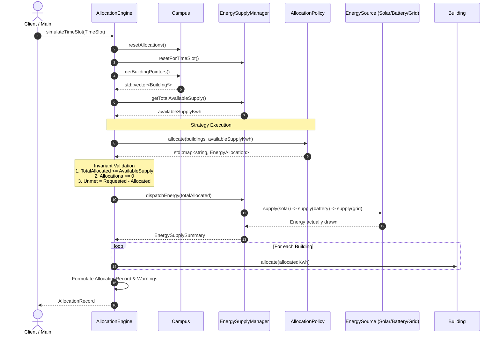

# Smart Campus Energy Allocation System — Architecture

This document describes the structural architecture, component design, data flow, and memory management model of the **Smart Campus Energy Allocation System**.

---

## 1. System Overview

The system simulates electricity distribution across a university campus during discrete time slots (e.g. 2-hour intervals).
Each time slot processes building load requests against three heterogeneous energy sources (**Solar**, **Battery Energy Storage (BESS)**, and **Municipal Power Grid**), applying a selectable allocation policy (**Priority-Based** or **Fair-Share Proportional**) while strictly maintaining physical and mathematical conservation invariants.

```
       +-----------------------------------------------------------+
       |                  Discrete Time Slot                       |
       +-----------------------------------------------------------+
                                     |
                                     v
       +-----------------------------+-----------------------------+
       |                                                           |
       v                                                           v
+---------------------+                                     +---------------------+
|  Campus Buildings   |                                     |    Energy Sources   |
|  * Essential Load   |                                     |  * Solar PV         |
|  * Discretionary    |                                     |  * Battery (BESS)   |
|  * Priority Ranking |                                     |  * Municipal Grid   |
+----------+----------+                                     +----------+----------+
           |                                                           |
           +-----------------------------+-----------------------------+
                                         |
                                         v
                         +-------------------------------+
                         |      Allocation Engine        |
                         |  (Enforces Conservation &     |
                         |   Dispatches via Policy)      |
                         +---------------+---------------+
                                         |
                         +---------------+---------------+
                         |                               |
                         v                               v
             +-----------------------+       +-----------------------+
             |   Priority Policy     |       |   Fair-Share Policy   |
             +-----------------------+       +-----------------------+
                                         |
                                         v
                         +---------------+---------------+
                         |   Record & Audit Reports      |
                         |  * Fully / Partially Met /    |
                         |    Deferred Status            |
                         |  * Battery SoC Tracking       |
                         |  * Shortage & Surplus Notices |
                         +-------------------------------+
```

---

## 2. Object-Oriented Class Diagram

The following Mermaid class diagram illustrates the complete domain architecture, showing base classes, inheritance hierarchies, composition, aggregation, and realization.

```mermaid
classDiagram
    %% Core Interfaces & Base Classes
    class Building {
        <<abstract>>
        -string m_id
        -string m_name
        -BuildingCategory m_category
        -PriorityLevel m_priority
        -double m_essentialDemand
        -double m_discretionaryDemand
        -double m_allocatedEnergy
        -static int s_activeBuildingCount
        #setAllocatedEnergy(double kwh)
        +Building(id, name, category, priority, essential, disc)
        +virtual ~Building()
        +virtual string getTypeName()* const
        +virtual void allocate(double energyKwh)*
        +virtual void resetAllocation()
        +double getEssentialDemand() const
        +double getDiscretionaryDemand() const
        +double getTotalDemand() const
        +double getAllocatedEnergy() const
        +double getUnmetDemand() const
        +FulfillmentStatus getFulfillmentStatus() const
        +static int getActiveBuildingCount()
    }

    class AcademicBuilding {
        -int m_classroomCount
        -bool m_hasSmartBoards
        +AcademicBuilding(id, name, priority, essential, disc, rooms, boards)
        +string getTypeName() override
        +void allocate(double energyKwh) override
    }

    class Laboratory {
        -int m_hazardousFumeHoods
        -bool m_backupGeneratorRequired
        -double m_safetyCriticalBaselineKwh
        +Laboratory(id, name, priority, essential, disc, rooms, boards, hoods, gen)
        +string getTypeName() override
        +void allocate(double energyKwh) override
    }

    class ResidentialBuilding {
        -int m_residentCapacity
        +ResidentialBuilding(id, name, priority, essential, disc, capacity)
        +string getTypeName() override
        +void allocate(double energyKwh) override
    }

    class Hostel {
        -int m_numberOfRooms
        -bool m_hasDiningMess
        -double m_messKitchenLoadKwh
        +Hostel(id, name, priority, essential, disc, capacity, rooms, mess)
        +string getTypeName() override
        +void allocate(double energyKwh) override
    }

    class AdministrativeBuilding {
        -string m_department
        -bool m_hasDataServerRoom
        +AdministrativeBuilding(id, name, priority, essential, disc, dept, serverRoom)
        +string getTypeName() override
        +void allocate(double energyKwh) override
    }

    %% Inheritance relationships
    Building <|-- AcademicBuilding : Single Inheritance
    AcademicBuilding <|-- Laboratory : Multilevel Inheritance
    Building <|-- ResidentialBuilding : Single Inheritance
    ResidentialBuilding <|-- Hostel : Multilevel Inheritance
    Building <|-- AdministrativeBuilding : Single Inheritance

    %% Campus Composition
    class Campus {
        -string m_campusName
        -vector~unique_ptr~Building~~ m_buildings
        +Campus(campusName)
        +addBuilding(unique_ptr~Building~ building)
        +vector~Building*~ getBuildingPointers() const
        +Building* findBuildingById(string id) const
        +double getTotalEssentialDemand() const
        +double getTotalDiscretionaryDemand() const
        +double getTotalDemand() const
        +void resetAllocations()
    }
    Campus *-- Building : Owns (Composition)

    %% Energy Sources Hierarchy
    class EnergySource {
        <<abstract>>
        -string m_sourceId
        -string m_name
        #double m_capacityKwh
        +EnergySource(id, name, capacity)
        +virtual ~EnergySource()
        +virtual double getAvailableEnergy()* const
        +virtual double supply(double requestedKwh)*
        +virtual string getSourceName()* const
        +virtual void resetForTimeSlot()
    }

    class SolarSource {
        -double m_ratedPeakKw
        -double m_irradianceFactor
        -double m_slotDurationHours
        +double getAvailableEnergy() override const
        +double supply(double requestedKwh) override
        +string getSourceName() override
    }

    class BatterySource {
        -double m_currentSoCKwh
        -double m_maxChargeRateKw
        -double m_maxDischargeRateKw
        -double m_roundTripEfficiency
        -double m_minReserveRatio
        +double charge(double surplusEnergyKwh)
        +double getSoCPercentage() const
        +double getAvailableEnergy() override const
        +double supply(double requestedKwh) override
    }

    class GridSource {
        -double m_maxPowerKw
        -double m_availabilityFactor
        -double m_cumulativeEnergyDrawnKwh
        +double getAvailableEnergy() override const
        +double supply(double requestedKwh) override
    }

    EnergySource <|-- SolarSource : Single Inheritance
    EnergySource <|-- BatterySource : Single Inheritance
    EnergySource <|-- GridSource : Single Inheritance

    class EnergySupplyManager {
        -unique_ptr~SolarSource~ m_solar
        -unique_ptr~BatterySource~ m_battery
        -unique_ptr~GridSource~ m_grid
        +EnergySupplySummary dispatchEnergy(double totalDemandRequested)
        +double getTotalAvailableSupply() const
        +void resetForTimeSlot()
    }
    EnergySupplyManager *-- SolarSource : Owns
    EnergySupplyManager *-- BatterySource : Owns
    EnergySupplyManager *-- GridSource : Owns

    %% Policy Strategy Pattern
    class AllocationPolicy {
        <<interface>>
        +virtual ~AllocationPolicy()
        +virtual string getPolicyName()* const
        +virtual string getDescription()* const
        +virtual map~string, EnergyAllocation~ allocate(vector~Building*~ buildings, double availableSupplyKwh)*
    }

    class PriorityPolicy {
        +string getPolicyName() override const
        +map~string, EnergyAllocation~ allocate(vector~Building*~ buildings, double availableSupplyKwh) override
    }

    class FairSharePolicy {
        +string getPolicyName() override const
        +map~string, EnergyAllocation~ allocate(vector~Building*~ buildings, double availableSupplyKwh) override
    }

    AllocationPolicy <|.. PriorityPolicy : Realizes
    AllocationPolicy <|.. FairSharePolicy : Realizes

    %% Allocation Engine
    class AllocationEngine {
        -Campus& m_campus
        -EnergySupplyManager& m_supplyManager
        -shared_ptr~AllocationPolicy~ m_currentPolicy
        -vector~AllocationRecord~ m_simulationHistory
        +AllocationRecord simulateTimeSlot(TimeSlot slot)
        +void setPolicy(shared_ptr~AllocationPolicy~ policy)
    }

    AllocationEngine o-- AllocationPolicy : Strategy (Aggregation)
    AllocationEngine --> Campus : Interacts with (Association)
    AllocationEngine --> EnergySupplyManager : Interacts with (Association)
```



---

## 3. Simulation Workflow Sequence Diagram

The sequence diagram below models the execution trace when `AllocationEngine::simulateTimeSlot` is triggered:



---

## 4. Memory Ownership and Lifecycle Model

1. **Composition via `std::unique_ptr`**:
   - `Campus` has exclusive ownership of its `Building` instances using `std::vector<std::unique_ptr<Building>>`. When `Campus` is destroyed, all owned buildings are cleanly and polymorphically deallocated via `virtual ~Building()`.
   - `EnergySupplyManager` has exclusive ownership of its solar, battery, and grid hardware objects (`std::unique_ptr<SolarSource>`, etc.).
2. **Aggregation via `std::shared_ptr` / Reference**:
   - `AllocationEngine` maintains an association to `AllocationPolicy` via `std::shared_ptr<AllocationPolicy>`. Policies can be swapped at runtime via `engine.setPolicy(...)` without re-instantiating the engine or losing simulation state.
   - Non-owning observer pointers (`Building*`) are passed from `Campus` into `AllocationPolicy::allocate()` to query demands and IDs without exposing ownership transfer or copying.
3. **Copy Prevention**:
   - Polymorphic base classes (`Building`, `EnergySource`, `AllocationPolicy`, `AllocationEngine`) have their copy constructor and copy assignment explicitly `= delete`'d to eliminate dangerous object slicing. Move constructors and move assignment operators are defaulted where transfer of ownership is valid.

---

## 5. Domain Invariants and Safety Guarantees

The architecture strictly verifies the following guarantees on every simulation iteration:

| Invariant | Mathematical Expression | Enforcing Component | Violation Consequence |
| :--- | :--- | :--- | :--- |
| **Supply Ceiling** | $\sum \text{Allocated}_i \le \text{Supply}_{\text{available}}$ | `AllocationEngine::validateInvariants` | Throws `SupplyExceededException` |
| **Non-Negativity** | $\forall i, \text{Allocated}_i \ge 0$ | `Building::allocate`, `AllocationPolicy` | Throws `NegativeEnergyException` |
| **Demand Ceiling** | $\forall i, \text{Allocated}_i \le \text{Demand}_i$ | `Building::allocate`, Policies | Clamped & validated in engine |
| **Correct Unmet Calculation** | $\forall i, \text{Unmet}_i = \text{Demand}_i - \text{Allocated}_i$ | `Building::getUnmetDemand`, Engine | Throws `CampusEnergyException` |
| **Battery SoC Bounds** | $0 \le \text{SoC} \le \text{Capacity}$ | `BatterySource::supply`, `charge` | Clamped to bounds, rejects bad configs |
| **Battery Health Protection** | $\text{Discharge}_{\text{available}} \le \text{SoC} - \text{Reserve}$ | `BatterySource::getAvailableEnergy` | Discharge halts at reserve threshold |
